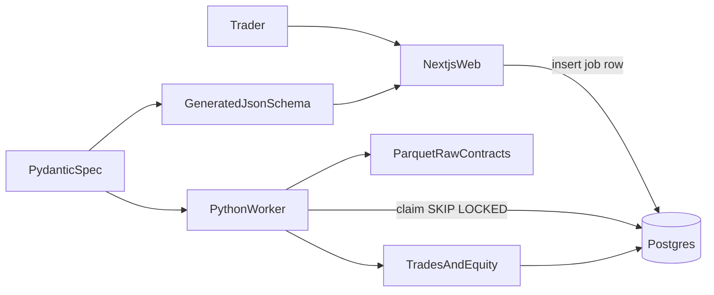

# Architecture

A trader describes a futures bot in plain English, or later by drawing on a chart. A language model turns that into a strategy spec. A deterministic Python engine does every calculation: patterns, fills, fees, and the Trust Score. The model never sizes a trade, detects a pattern, or simulates a fill.

Users see rule cards, not JSON. NQ comes first, ES second. If the engine is wrong, the product is dead, so engine tests come before any UI.

## Two parts, one database

`web` is a Next.js app and the only web server. Claude is called from server actions on the server. The browser never calls the model or the broker.

`engine` is a Python worker. It is not a web API. There is no FastAPI and no Redis. The web app inserts a job row in Postgres. The worker claims the oldest queued job with `SELECT ... FOR UPDATE SKIP LOCKED`, runs it, and writes the trades and equity curve back.

A running job that outlives the worker timeout goes back to the queue. After three attempts the job is marked dead and the error is saved. Supabase provides auth, Postgres, and file storage. Backtests do not run in edge functions.

## The strategy spec

The Pydantic model in `shared` is the only spec. Each save is a new version row with `parent_version`. The row stores JSONB plus `spec_version`. Old specs are migrated on read. A block type can be deprecated and must not be deleted.

The worker validates every spec with Pydantic before it runs. The web app cannot import Python, so a generated JSON Schema is the copy it validates against. TypeScript types are generated from the same model. Nobody hand-writes a second spec.

## Market data

Licensed Databento data is stored as Parquet and read with DuckDB. Polars computes features. The files are raw outright contracts. A pattern uses the front month: the outright with the higher volume. Prices are not back-adjusted. A fair value gap, sweep, or session level never uses bars from two contracts. Timestamps are stored in UTC. A session window is interpreted in its named timezone, including daylight saving time.

`fill_resolution` is a spec field. One-second data is the goal. One-minute fills are allowed when data cost requires it. Signals may use a higher timeframe than fills.

## Fills and honest tests

Fees and slippage are on. When one bar contains both the stop and the target and the fill data cannot prove which printed first, the stop fills. The exact fill rules are in `docs/SPEC.md`.

Honest testing is on from the start. Walk-forward is rolling: 12 months of training, then 3 months of test. The most recent 6 months are a locked holdout that no optimizer sees. A Trust Score requires at least 100 out-of-sample trades. It runs from 0 to 100 in three parts: works on unseen data, survives small parameter tweaks, and survives fees. Batches are ranked by the Deflated Sharpe. That formula is written down when the module is built. Monte Carlo reorders the same trades to show a worse drawdown. It does not invent new prices.

Phase 1 parity runs the same fixtures through vectorized detection and the event-driven simulator. The numbers must match. The paper and live bots will call those same Python functions.

## Going live

Paper trading is the default. The recommended wait before live is 5 trading days and 20 completed trades. Going sooner shows a warning and requires one logged confirmation. The daily-loss kill switch and the micro-contract size cap stay on after that skip. Full size waits until live results track the backtest. That comparison rule is defined before the unlock is built.

Broker connections store encrypted API keys. Tradovate is first, TopstepX second. Paper trading and read-only account sync come before live orders, and live order routing waits for a legal review.

When it is time to host: Vercel for the web app, Railway or Fly for the worker. One GitHub Action runs pytest, typecheck, and web tests, and a failure blocks merge. Secrets live in `.env.local` and in one env module that refuses to boot if a required key is missing.

## Out of scope

Pasting in bot code, NinjaScript or Pine export, custom model training, showing raw CME data to users, freeform AI-written execution code, options, and offshore crypto. Execution code stays on fixed templates.
